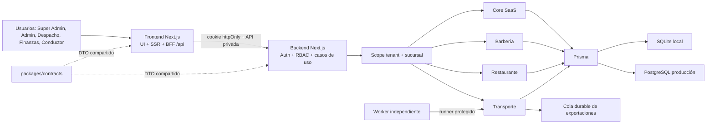
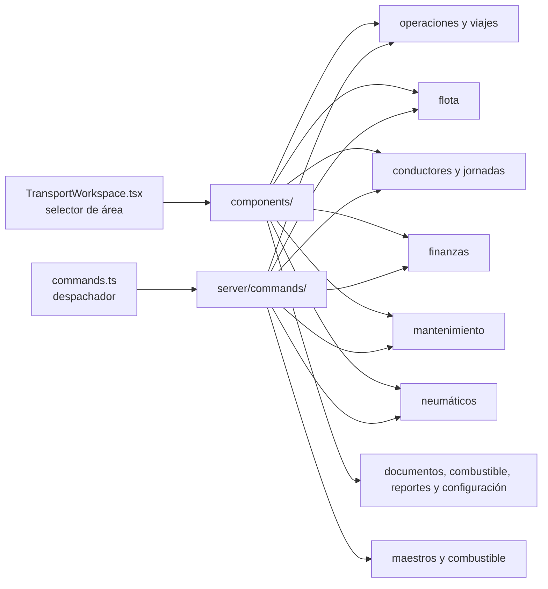

# Arquitectura V2 separada

V2 es un monorepo con dos servicios desplegables y un contrato compartido:



```text
Navegador
  -> apps/frontend (Next.js, UI, SSR y proxy /api)
       -> apps/backend (Next.js Route Handlers, sesión, RBAC y dominio)
            -> Prisma
                 -> SQLite local / PostgreSQL producción

packages/contracts <- DTOs y respuestas usados por ambos servicios
```

## Responsabilidades

- `apps/frontend`: páginas, layouts, componentes, CSS, manifiestos de navegación y un BFF delgado. No importa Prisma ni ejecuta reglas de escritura.
- `apps/backend`: autenticación, sesiones opacas, autorización, Super Admin, lecturas, comandos transaccionales, auditoría y persistencia.
- `packages/contracts`: tipos serializables de sesión, Barbería, Restaurante, Transporte, Core y Plataforma.
- `apps/backend/prisma`: esquema, migraciones, bootstrap y seed reproducible.
- `e2e`: pruebas desde el navegador contra los dos procesos reales.

## Modularización interna de Transporte

El vertical de Transporte conserva un único punto de entrada por capa, pero ya no concentra la implementación en esos archivos. Los puntos de entrada sólo seleccionan el área o delegan el comando; cada dominio mantiene su propia UI y sus reglas de servidor.



```text
apps/frontend/src/modules/transport/
  TransportWorkspace.tsx       selector pequeño de las 11 áreas
  components/                  un componente por capacidad
    operations.tsx             viajes, asignaciones, tracking e incidentes
    fleet.tsx                  vehículos y remolques
    workforce.tsx              conductores, jornadas y descansos
    finance.tsx                gastos, pagos y liquidaciones
    maintenance.tsx            órdenes e inventario
    tires.tsx                  neumáticos, inspecciones y movimientos
    documents.tsx, fuel.tsx, reports.tsx, settings.tsx, dashboard.tsx
    transport-ui.tsx           utilidades visuales compartidas

apps/backend/src/modules/transport/server/
  commands.ts                  despachador sin lógica de dominio
  command-types.ts             contrato interno de handlers
  command-schemas.ts           validación Zod compartida
  command-helpers.ts           scope y reglas transversales
  commands/                    handlers por dominio
    operations.ts, fleet.ts, workforce.ts, finance.ts
    maintenance.ts, tires.ts, fuel.ts, masters.ts
  exports.ts                   Excel/PDF y procesamiento de trabajos pesados
```

Después de esta separación, `TransportWorkspace.tsx` pasó de aproximadamente 42 KB a 1,6 KB y `commands.ts` de aproximadamente 40 KB a 1,2 KB. La regla de evolución es extender el archivo de dominio correspondiente y mantener ambos puntos de entrada como composición, sin volver a incorporar lógica operativa en ellos.

La lectura sigue el mismo límite: la página envía la sección actual al backend y `getTransportData` ejecuta sólo el plan de consultas de esa capacidad. La ausencia de `section` conserva el workspace completo para compatibilidad con integraciones y pruebas, mientras que la UI normal usa respuestas acotadas. Las respuestas privadas nunca se cachean de forma compartida.

Los Server Components consultan el backend con `API_INTERNAL_URL`. Las operaciones iniciadas en el navegador conservan `/api/*` en el dominio del frontend; el Route Handler comodín reenvía método, body, cookies y respuesta al backend. Así la cookie sigue siendo `httpOnly` y no se expone la dirección privada del API.

En Google Cloud Run el frontend puede obtener automáticamente un identity token desde el metadata server cuando se configura `GOOGLE_CLOUD_RUN_AUDIENCE`; esto permite mantener el backend privado y conceder `roles/run.invoker` únicamente a la cuenta de servicio del frontend.

## Autenticación, autorización y tenancy

El login valida `email + contraseña + businessSlug`. El navegador recibe un token aleatorio en cookie `httpOnly`, `sameSite=lax`; la base conserva únicamente su hash SHA-256 y expiración.

```text
request -> sesión -> membresía activa -> tenant/sucursal -> permiso
        -> caso de uso -> consulta/transacción con scope -> auditoría
```

El backend deriva `tenantId` y `branchId` de la sesión. Nunca confía en esos identificadores enviados por el cliente. Las entidades relacionadas también se vuelven a consultar dentro del scope antes de escribir.

El login registra intentos en `LoginThrottle` usando una llave SHA-256 de origen, correo y empresa; no persiste esos valores en texto legible. Cinco fallos dentro de la ventana configuran un bloqueo temporal y devuelven HTTP 429 con `Retry-After`. El estado vive en la base y funciona entre procesos. Al crear una sesión se eliminan sesiones ya expiradas del usuario.

Antes de una escritura, el backend valida que el plan y la suscripción permitan operar. Las altas de citas, pedidos y viajes respetan el máximo mensual del plan, y el alta de usuarios respeta `maxUsers`. Una suscripción vencida, cancelada o con pago pendiente conserva lectura para recuperación administrativa, pero no acepta nuevas escrituras operativas.

## Dominio implementado

- Core: `Tenant`, `Branch`, `User`, `Membership`, `Role`, `Session`, `AuditLog`.
- Compartido: `Customer`, `CashSession`, `Sale`.
- Barbería: `StaffMember`, `StaffSchedule`, `Service`, `Appointment`.
- Restaurante: `Category`, `Product`, `DiningArea`, `DiningTable`, `RestaurantOrder`, `OrderItem`, `KitchenTicket`.
- Transporte: 23 modelos para maestros/rutas, flota, conductores/jornadas, viajes/asignaciones, seguimiento/documentos/incidentes, finanzas, combustible, mantenimiento/inventario, neumáticos y trabajos de datos pesados.
- Plataforma: planes, suscripciones, catálogo, métricas globales y administración de empresas.
- Comercial: 7 modelos para checkout, cliente de cobro, suscripción histórica, factura, pago, webhook idempotente y outbox de correo.

Las escrituras compuestas usan transacciones Prisma. Un vertical nuevo debe aportar contratos serializables, comandos/lecturas con `TenantScope`, componentes y pruebas de aislamiento antes de registrarse.

## Coste de la separación

No se eliminó funcionalidad del alcance operativo validado. Las integraciones externas del original que no tenían credenciales o ciclo completo se mantienen fuera del núcleo y se conectarán mediante adaptadores. El coste operativo es tener dos despliegues, dos health checks y una URL interna que configurar. A cambio, el frontend no posee credenciales de base de datos, cada capa escala y se despliega por separado, y las reglas de negocio quedan centralizadas en el API.
