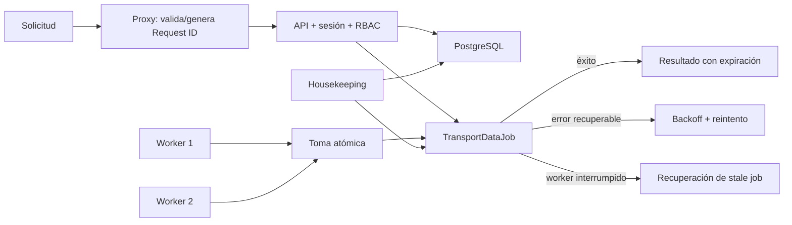

# Fase 3 — fiabilidad y operación productiva

Fecha: 16 de agosto de 2026.

## Alcance implementado

- `X-Request-Id` validado o generado para todas las rutas del backend.
- Logs JSON estructurados para arranque, errores, salud, trabajos, reintentos y limpieza.
- `/api/health` como liveness y `/api/ready` como readiness con base de datos y estado de cola.
- Health del frontend conectado al health real del backend.
- Alertas operativas reales y limitadas por RBAC para Barbería, Restaurante y Transporte.
- Estado técnico real en Super Admin: sesiones, auditoría, cola, procesamiento, fallos y trabajos estancados.
- Trabajos con toma atómica multi-worker, máximo de intentos, backoff exponencial, recuperación de interrupciones y vencimiento de descargas.
- Limpieza periódica de sesiones vencidas, throttles antiguos, binarios expirados, metadatos de trabajos y auditoría según retención.
- Pantallas profesionales de recuperación para errores de segmento y errores globales.

## Flujo operativo

## Variables de producción

Configurar `JOB_RUNNER_SECRET`, `JOB_MAX_ATTEMPTS`, `JOB_RETRY_BASE_SECONDS`, `JOB_STALE_MINUTES`, `EXPORT_RETENTION_HOURS`, `HOUSEKEEPING_INTERVAL_MINUTES`, `JOB_METADATA_RETENTION_DAYS`, `AUDIT_RETENTION_DAYS`, `LOGIN_THROTTLE_RETENTION_DAYS` y `DEPLOYMENT_VERSION`. Los valores recomendados están en `apps/backend/.env.example`.

## Validación

La suite `npm run e2e:phase3` ejecuta 15 escenarios reales: health/readiness, correlación, frontend-backend, alertas/RBAC/UI, metadatos de trabajos, workers concurrentes, secreto inválido, recuperación de trabajo interrumpido, reintento, agotamiento y métricas técnicas de Super Admin.

## Deuda detectada antes de la fase

La línea histórica de migraciones SQLite no puede reconstruirse desde cero: la migración de Fase 2 referencia tablas de Transporte que no aparecen en migraciones anteriores. La base actual y el esquema están sincronizados sin pérdida mediante `prisma db push`, que es también el mecanismo productivo configurado para PostgreSQL. Antes de cambiar producción a `prisma migrate deploy`, debe crearse y validar una migración baseline del esquema completo sobre una base vacía y una copia restaurada.

## Límite siguiente

La Fase 4 debe mover binarios de exportación y documentos a Cloud Storage/S3 compatible con URLs firmadas, antivirus y políticas de ciclo de vida. Esta fase ya aplica vencimiento, pero aún guarda el binario temporal dentro de la base.
