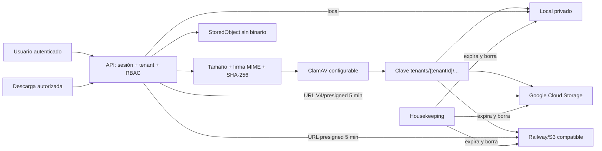

# Fase 4 — almacenamiento privado de objetos

Fecha: 16 de agosto de 2026.

## Resultado

Las exportaciones asíncronas ya no guardan Base64 dentro de la base de datos. Documentos y exportaciones usan un adaptador común con tres proveedores: disco privado local para desarrollo, Google Cloud Storage y S3 compatible para Railway Buckets, AWS S3, Cloudflare R2 o MinIO.

Se añadió una sola tabla, `StoredObject`, para conservar tenant, actor, proveedor, bucket, clave, nombre original, MIME verificado, tamaño, SHA-256, propósito, estado antivirus, expiración y borrado. `TransportDocument` y `TransportDataJob` solo guardan la relación.

## Seguridad aplicada

- Bucket nunca público.
- Claves con prefijo de tenant y UUID no predecible.
- Descarga únicamente después de sesión, rubro, tenant, permiso y actor cuando es una exportación.
- PDF/JPEG/PNG/WebP comprobados por firma binaria; no se confía en extensión ni MIME del navegador.
- Máximo configurable, hash SHA-256, `nosniff` y nombre saneado.
- ClamAV por streaming configurable; `REQUIRE_ANTIVIRUS=true` bloquea cargas si el escáner no está disponible.
- URLs firmadas cortas, 300 segundos por defecto.
- Expiración física y lógica mediante housekeeping; metadatos se conservan para auditoría.

## Compatibilidad

Los trabajos antiguos con `resultData` Base64 continúan descargándose hasta expirar. Los documentos antiguos con URL externa siguen abriéndose mediante la ruta autorizada. Todo archivo nuevo usa `StoredObject`.

## Validación

Ejecutar `npm run e2e:phase4`. La suite cubre carga anónima/RBAC, titular ajeno, ejecutable, MIME falso, metadatos sin archivo, hash y aislamiento, descarga exacta, UI, rubro incorrecto, exportación sin Base64, aislamiento por actor, expiración física, readiness y Super Admin.
