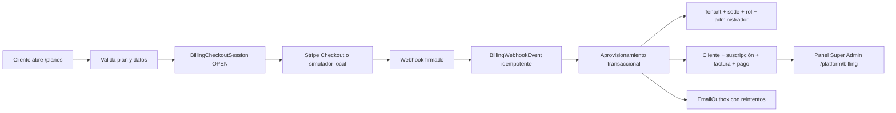

# Fase 5 · Comercialización y cobro automático

## Estado real

La arquitectura comercial está implementada y validada sin depender de credenciales personales. En local y E2E usa un proveedor `mock` identificado como simulador. En producción el proveedor esperado es Stripe y permanece `pending_configuration` hasta definir `STRIPE_SECRET_KEY`, `STRIPE_WEBHOOK_SECRET` y `APP_PUBLIC_URL`.

No se considera un cobro real hasta conectar una cuenta Stripe, registrar el webhook y ejecutar una transacción de prueba en el sandbox de Stripe.

## Flujo implementado

## Tablas nuevas

Se agregaron siete tablas; el modelo pasó de 47 a 54 tablas:

1. `BillingCheckoutSession`: contratación y datos de aprovisionamiento temporal.
2. `BillingCustomer`: identidad de cobro por tenant.
3. `BillingSubscription`: historial y periodo de suscripciones.
4. `BillingInvoice`: facturas y estado de cobranza.
5. `BillingPayment`: intentos exitosos o fallidos.
6. `BillingWebhookEvent`: idempotencia, estado, error y reintentos.
7. `EmailOutbox`: notificaciones durables con hasta cinco intentos.

Los campos existentes en `Tenant` continúan sincronizados para conservar compatibilidad con permisos, límites y pantallas anteriores.

## Seguridad y comportamiento

- Validación Zod en servidor; contraseña fuerte y honeypot.
- Detección previa de slug, correo y checkout abierto duplicados.
- Límite temporal de cinco intentos por correo en quince minutos.
- Contraseña almacenada sólo como hash bcrypt y eliminada del checkout al completar o expirar.
- Firma Stripe verificada por el SDK oficial; firma HMAC para el simulador.
- Evento único por `(provider, externalEventId)` y reanudación controlada de eventos fallidos.
- Aprovisionamiento de empresa, acceso y suscripción dentro de una transacción.
- Estados `ACTIVE`, `PAST_DUE` y `CANCELLED` sincronizados con el tenant.
- Readiness expone proveedor configurado, eventos fallidos y correos pendientes sin secretos.
- El simulador y el correo `log` están bloqueados en producción salvo una habilitación explícita destinada sólo a E2E.

## Validación

`npm run e2e:phase5` ejecuta 22 escenarios desde una copia aislada de la base: catálogo público, UI, validaciones, duplicados, firma inválida/válida, aprovisionamiento, inicio de sesión, idempotencia, pago fallido, recuperación, cancelación, RBAC, panel, readiness y outbox.

La implementación sigue el patrón recomendado por Stripe: Checkout de suscripción, aprovisionamiento tras eventos y manejo de `invoice.paid`/`invoice.payment_failed`. Referencias: [Checkout de suscripciones](https://docs.stripe.com/payments/checkout/build-subscriptions), [webhooks de suscripciones](https://docs.stripe.com/billing/subscriptions/webhooks) y [firmas de webhooks](https://docs.stripe.com/webhooks/signature).

## Conexión externa pendiente

1. Crear o seleccionar la cuenta Stripe y obtener claves de sandbox.
2. Configurar el webhook público del frontend `/api/billing/webhooks/stripe`.
3. Elegir el proveedor de correo y conectar `EMAIL_WEBHOOK_URL` o reemplazar el adaptador.
4. Desplegar en Railway o Google Cloud con PostgreSQL y almacenamiento privado.
5. Ejecutar un cobro sandbox, una renovación fallida y una cancelación desde Stripe.
6. Sólo después, rotar a claves live y habilitar venta pública.
