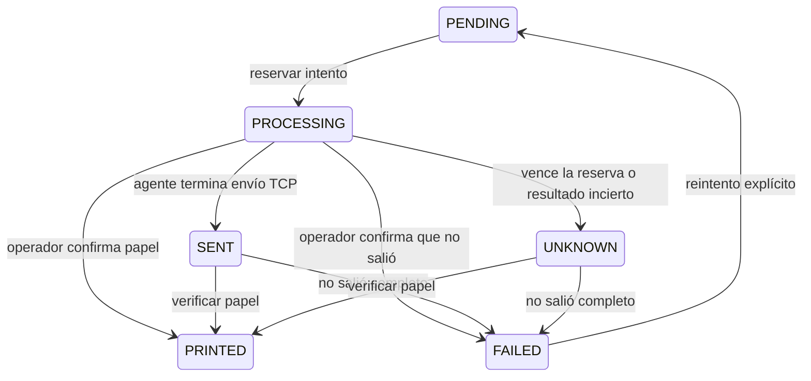

# Impresión compartida: entrega y confirmación

Entrega del 13 de septiembre de 2026, dentro de la etapa 6. Se extrae el control de entrega de impresión a `modules/printing` conservando las tablas actuales. Restaurante sigue definiendo áreas, productos, adicionales, anulaciones, contenido y destino de sus comandas.

## Arquitectura

Se mantiene el monolito modular con arquitectura hexagonal ligera. La entrega usa una máquina de estados en dominio, el caso `changeDelivery`, el puerto `PrintRepository` y un adaptador Prisma ligado a una transacción serializable. Las fachadas HTTP y el agente utilizan ese mismo caso; no hay dos implementaciones de reserva y confirmación.

`attempts` identifica cada toma. `deliveryAttempt` identifica una reimpresión habilitada expresamente y mantiene la identidad del diario local del agente. Se comprueban empresa, sucursal, impresora, estación, estado e intento antes de modificar el trabajo. Transición y auditoría se confirman o revierten juntas.

## Recuperación

Una reserva vencida no autoriza otra impresión. La consulta de Cocina la presenta como incierta y el agente solo toma trabajos `PENDING`. Si se intenta reclamar la reserva vencida por API, queda `UNKNOWN` con auditoría; la consulta por sí sola no modifica registros. Una reserva antigua sin vencimiento se trata también como incierta.

En Cocina, **Enviadas o sin confirmar → Verificar papel** permite marcar **Recibida en papel** o **No salió**. Solo después de confirmar que no salió queda disponible **Reimprimir**. El nuevo intento tiene otro contador; la respuesta tardía de la misma estación/agente no puede confirmar ese intento.

El agente conserva un diario local antes de enviar bytes. Un registro `SENT` no vuelve a enviarse; un registro incierto o dañado tampoco habilita otro envío. Un socket cerrado correctamente acredita transporte, no salida en papel. La API del agente admite envío, fallo o incertidumbre; la confirmación física corresponde al operador. No se promete exactamente una impresión ante todos los fallos de equipos o procesos.

## Actualización del agente

El protocolo pasa a la versión 2. El servidor devuelve la versión en el heartbeat y exige `protocolVersion: 2` antes de reservar. Cada actualización de estado incluye el `attempt` recibido. Un agente antiguo recibe HTTP 426 sin tomar un trabajo; el agente nuevo se detiene al iniciar contra un servidor anterior.

Actualizar el script `scripts/restaurant-print-agent.mjs` junto con el servidor y recargar las estaciones de navegador. Mantener `PRINT_STATE_DIR` y su diario entre reinicios; no borrar el diario para forzar una reimpresión. Las variables de conexión y el comando de ejecución existentes se conservan.

Antes de revertir código o cambiar la instalación, detener los agentes y revisar los trabajos enviados o inciertos. Una versión anterior que recupera reservas vencidas automáticamente no debe operar sobre esa cola sin conciliarla. No hacen falta migraciones ni restaurar datos para esta entrega.

## Limpieza y compatibilidad

- Eliminados los bloques duplicados de reserva, confirmación y reintento en el manejador de Restaurante y la ruta del agente. La ruta ahora traduce Request/Response y delega al módulo.
- La cola continúa usando `RestaurantPrintJob` y `PrintDevice`; no se renombraron tablas ni se reescribió el historial.
- El ruteo de anulaciones y la creación de trabajos verifican pertenencia del pedido. La impresión de prueba se confirma junto con su auditoría.
- El agente deja de autenticarse si se desactiva su sede o empresa. El navegador no toma trabajos asignados a un agente local.
- Retirado `scripts/validate-print-agent.mjs`, sin referencias en código o documentación: era una validación puntual con una URL de producción fija. La verificación reproducible utiliza el agente real contra API y socket locales de prueba.
- Añadidas restricciones de imports para que dominio y aplicación de impresión no dependan de Prisma, HTTP ni otros adaptadores.

## Verificación

Backend: 143 pruebas aprobadas; 22 escenarios exclusivos de PostgreSQL omitidos solo en SQLite. PostgreSQL 17 real y aislado: 106 pruebas aprobadas, sin omisiones, incluidas concurrencia de estaciones, agentes, confirmaciones y reintentos. Las 20 migraciones PostgreSQL coinciden con el esquema.

La prueba del proceso del agente usa API HTTP y socket TCP en loopback. Verifica la identidad de intento, la persistencia del envío, la ausencia de reenvío y la recuperación conservadora ante diario incierto o dañado. Se añadió a `release:check`; también puede ejecutarse con `npm run test:printing:agent`. La suite de base de datos puede aislarse con `npm run test:printing:postgres`.

Regresión E2E: 37 escenarios distintos aprobados, 33 de Restaurante y 4 de Minimarket. Cocina verifica por API y pantalla la revisión del papel sin otra impresión. TypeScript, lint del código afectado y builds de producción de ambos servicios aprobados. Persiste el diagnóstico no fatal de Next «The destination stream closed early» observado en entregas anteriores; las pruebas aprobaron y no se declara resuelto ese diagnóstico.

La comprobación visual de Cocina se repitió de forma aislada y aprobó. Captura revisada: `output/printing/printing-review.png`. Los nuevos eventos de auditoría tienen nombres legibles en el historial de actividad y se conservan los nombres anteriores para las entradas históricas.

## Alcance pendiente

No se instaló ni se conectó un agente permanente a una impresora real. La aceptación fiscal con una cuenta real de pruebas, la prueba física y la operación supervisada siguen pendientes antes de publicar. La etapa 6 permanece en validación; las etapas 7, 8 y 9 no se dan por completadas por esta extracción.

El consumidor integrado del canal de impresión es Restaurante. Minimarket conserva su ticket interno imprimible por navegador y los archivos fiscales del proveedor. Esta entrega no añade una balanza ni un agente de impresión física de tickets de Minimarket.
