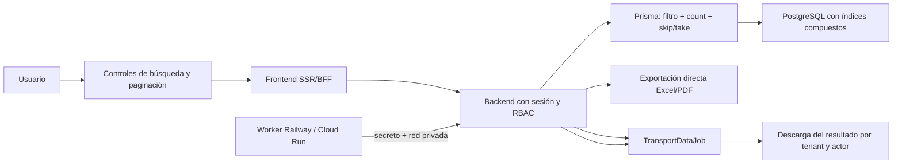

# Transporte V2 — Fase 2 de rendimiento y datos masivos

Fecha de cierre: 16 de agosto de 2026.

## Resultado

La Fase 2 quedó implementada y validada. Las listas principales ya no descargan cientos de filas para paginarlas en el navegador: el frontend envía `page`, `pageSize`, `q` y `status`; Prisma ejecuta `skip`, `take`, filtros y `count` dentro del scope de tenant/sucursal; la respuesta entrega metadatos reales de paginación.

Áreas cubiertas: viajes, flota, conductores, documentos, finanzas, combustible, mantenimiento, neumáticos y empresas vinculadas. Dashboard y reportes conservan su consulta agregada específica.

## Capacidades incorporadas

- Paginación de servidor de 10, 25, 50 o 100 filas.
- Búsqueda y estado aplicados antes de serializar la respuesta.
- Controles responsive con total, rango y navegación accesible.
- Exportación del resultado filtrado a CSV, Excel compatible (`.xls`) y PDF real.
- Importación CSV validada y atómica para empresas vinculadas, vehículos y conductores, hasta 1.000 filas por solicitud.
- Cola durable `TransportDataJob` con estados `QUEUED`, `PROCESSING`, `COMPLETED` y `FAILED`.
- Worker local directo y runner HTTP protegido para Railway/Cloud Run.
- Nueve índices compuestos nuevos para orden, estado y filtros de los dominios principales.

## Prueba de volumen aislada

`npm run transport:load` copia `dev.db` a un directorio temporal, inserta datos allí y elimina únicamente esa copia al terminar. La base local normal no se modifica.

| Operación con 10.000 viajes | p50 | p95 |
| --- | ---: | ---: |
| Primera página de 25 | 0,63 ms | 1,42 ms |
| Página profunda de 25 | 1,17 ms | 6,91 ms |
| Filtro `IN_TRANSIT` | 0,64 ms | 1,75 ms |
| Búsqueda de código | 4,19 ms | 14,74 ms |
| Conteo `DELIVERED` | 0,71 ms | 6,40 ms |

La carga de 10.000 viajes demoró 932,36 ms en SQLite local. El script acepta `TRANSPORT_LOAD_RECORDS` entre 10.000 y 100.000 para una corrida mayor en el ambiente objetivo.

## Evidencia funcional

- 10/10 escenarios nuevos de Fase 2: anónimo, conteo/paginación, búsqueda, filtro, UI, Excel, PDF, importación inválida/válida y encolado.
- 30/30 escenarios reales anteriores de Transporte repetidos después del cambio.
- 5/5 pruebas unitarias aprobadas.
- TypeScript, ESLint y build optimizado de backend/frontend aprobados.
- Ciclo real de cola probado: crear job → runner HTTP → `COMPLETED` → descargar PDF/Excel con HTTP 200.
- Localhost, backend y acceso por IP privada responden HTTP 200.

## Límite deliberado

Los resultados binarios de esta fase se guardan en la base para mantener una cola durable y portable. Antes de exportaciones de cientos de miles de filas, la Fase 4 debe mover esos archivos a almacenamiento de objetos (Cloud Storage/S3 compatible), aplicar expiración y descargar mediante URL firmada. La paginación normal ya evita que ese volumen afecte la navegación diaria.
